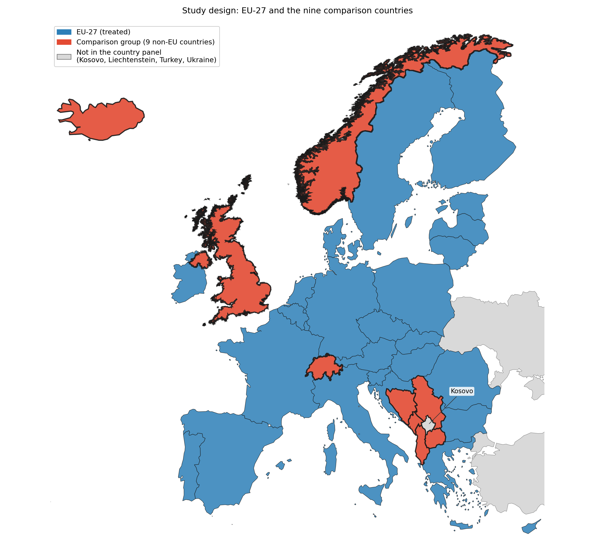
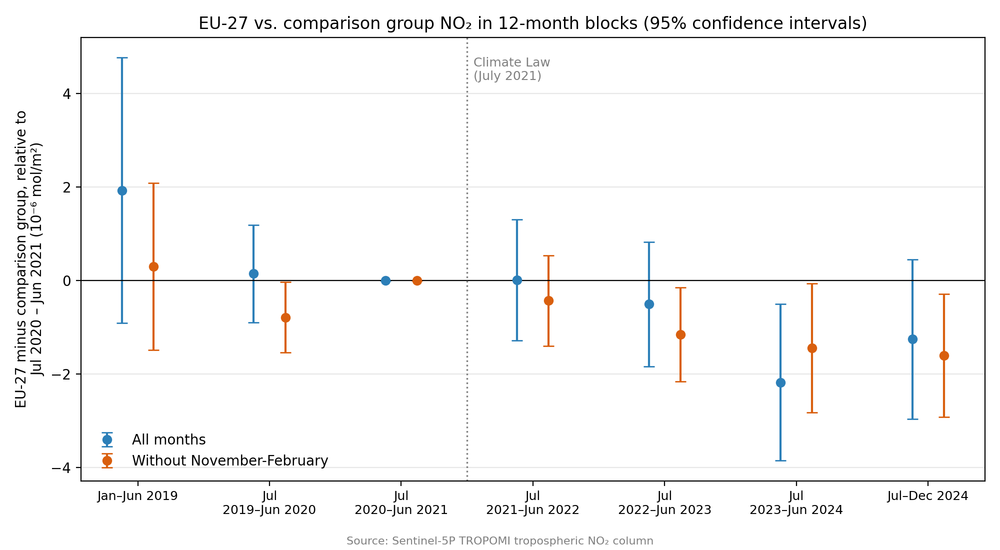
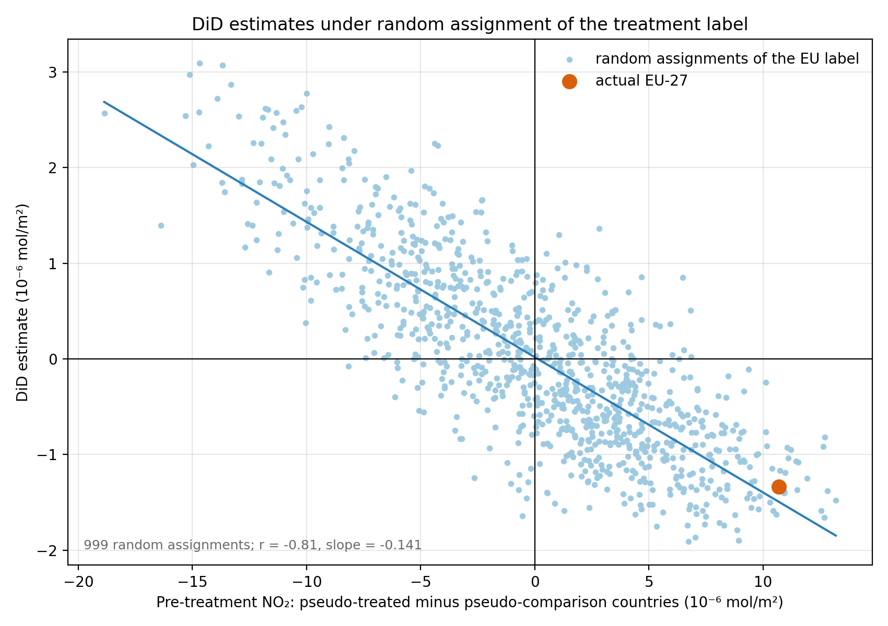
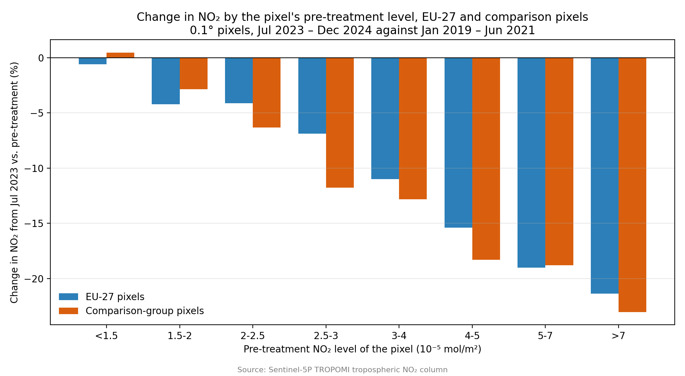
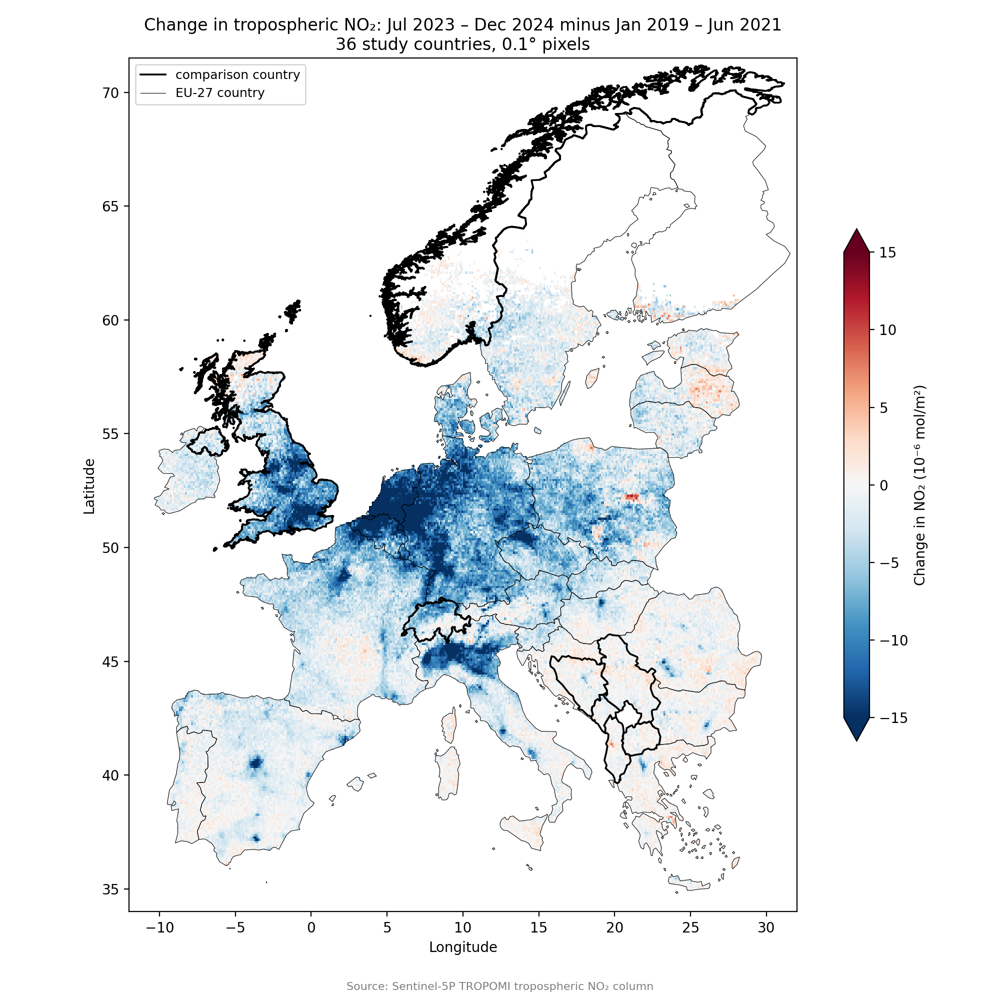
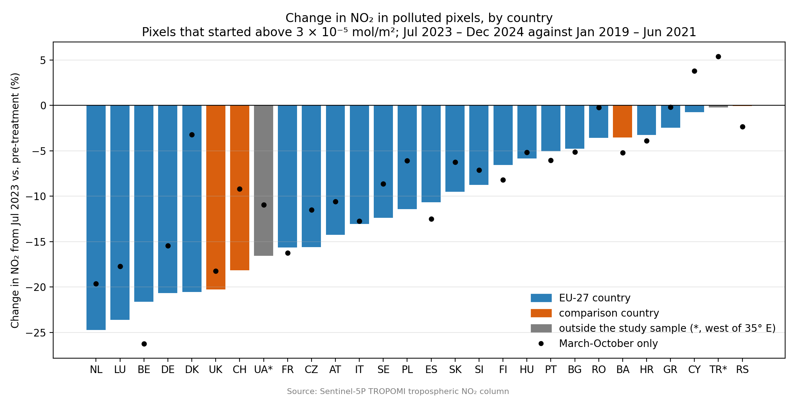

# What Does a Country-Level Difference-in-Differences on Satellite NO₂ Identify? Baseline Composition, Winter Retrievals and the European Climate Law

**Sakshi D. Maske**

*Independent Geospatial Researcher*

## Abstract

Satellite observations make it easy to compare air pollution in countries that adopted a policy with countries that did not. This paper examines what such a comparison identifies, using Sentinel-5P TROPOMI tropospheric NO₂ for 2019–2024 and a country-level difference-in-differences (DiD) model of the European Climate Law that compares the EU-27 with nine neighbouring non-EU countries. NO₂ fell by 1.34 × 10⁻⁶ mol/m² more in the EU-27 (4.3% of its pre-treatment level; p = 0.022). The estimate is stable under year-month fixed effects, group-specific seasonality, meteorological and COVID-19 controls, a wild cluster bootstrap and the removal of any single comparison country. It is not stable without the winter months (p = 0.11), with countries weighted by area (p = 0.11), with log GDP (p = 0.21), or under randomization inference on the coefficient (p = 0.17), and it appears only from the third year after the law. Most of it reflects the composition of the two groups. When the treatment label is assigned to random sets of countries, the estimate tracks how much more polluted the labelled group was before treatment (r = −0.81), and the EU-27's estimate is what its pre-treatment level predicts. On a 0.1° grid, comparing EU and comparison-group pixels that started at the same NO₂ level reduces the estimate to −0.21 × 10⁻⁶ (95% CI −0.67 to +0.24). Descriptively, polluted areas lost about 15–25% of their NO₂ in north-western Europe, including the non-EU United Kingdom and Switzerland, and little in south-eastern Europe, including several EU members, in western Turkey and in Serbia. The data cannot separate EU membership from region, shared emission standards or winter retrieval conditions. Country-level DiD on satellite NO₂ should be checked against comparisons matched on baseline pollution before it is read as a policy effect.

**Keywords:** nitrogen dioxide; TROPOMI; difference-in-differences; aggregation; parallel trends; policy evaluation

## 1. Introduction

Tropospheric nitrogen dioxide (NO₂) is one of the few air pollutants that can be observed from space every day, almost everywhere, with a single instrument. Since the launch of Sentinel-5P in 2017, the TROPOMI instrument (Veefkind et al., 2012) has made it possible to compare NO₂ across borders without relying on national monitoring networks or self-reported inventories. Satellite-derived pollution is now a common outcome in quasi-experimental studies in which the unit of analysis is an administrative area: counties exposed to a trade shock (Chen et al., 2020), cities that opened subway systems (Gendron-Carrier et al., 2022), and countries or first-level regions under COVID-19 lockdowns (Dang & Trinh, 2021; Keola & Hayakawa, 2021). The design is attractive because it is simple: compare the change in pollution in treated areas with the change in untreated ones.

This paper asks what a design of this kind identifies when the treated and comparison areas differ in how polluted they are to begin with. The question matters because the change in a satellite NO₂ column depends on its level. Clean areas have little to lose, a background contribution from the free troposphere does not respond to surface emissions (Silvern et al., 2019), and the retrieval itself is biased by amounts that depend on pollution level (Verhoelst et al., 2021). If NO₂ falls more where it is higher, two groups of countries with different shares of polluted area will diverge even when comparable places change in the same way, and a difference-in-differences (DiD) in levels will record the divergence as a treatment effect.

The case studied is the European Climate Law (Regulation (EU) 2021/1119), adopted on 30 June 2021. It applies to all 27 member states from the same date and not to their neighbours, which gives a clean two-group design. It is also a case in which a dated effect on NO₂ is implausible: the law sets a binding target of climate neutrality by 2050 and an intermediate target for 2030, while NO₂ in Europe is governed by other instruments, among them vehicle emission standards, the Industrial Emissions Directive (2010/75/EU) and the National Emission reduction Commitments Directive ((EU) 2016/2284), and road transport is its main source (European Environment Agency, 2025). A country-level DiD around July 2021 is therefore a test of the method more than of the law: an estimate that looks like an effect needs another explanation.

The paper proceeds in three steps. It first estimates the country-level DiD and reports its behaviour under a wide set of specifications in one table, without sorting them into those that support the estimate and those that do not. It then tests whether the estimate reflects baseline composition, using a country-level interaction, a placebo exercise with random assignment of the treatment label, and a pixel-level comparison matched on pre-treatment NO₂. Finally it describes where NO₂ fell, country by country, including areas outside the study sample.

There are three findings. The country-level estimate is negative and significant under many standard specifications, and fragile under others that are rarely reported: the treatment of winter retrievals, country weighting and the functional form of the GDP control. Most of the estimate is accounted for by the difference in pre-treatment pollution between the two groups; comparisons matched on that level leave an estimate that is small and not distinguishable from zero. And the decline in polluted areas is geographically uneven in a way that does not follow the EU border, although the data cannot say why.

Section 2 reviews related work. Section 3 describes the data and Section 4 the methods. Section 5 presents the results, Section 6 discusses them, Section 7 lists limitations and Section 8 concludes.

## 2. Related Work

### 2.1 Satellite NO₂: Trends, Retrieval and Meteorology

TROPOMI NO₂ columns have been used widely to measure the atmospheric response to discrete events, above all the COVID-19 lockdowns, during which reductions of tens of percent were reported over European cities (Barré et al., 2021; Vîrghileanu et al., 2020). Longer satellite records show that European NO₂ has declined for two decades, at rates that differ between regions and that have slowed or reversed in places (Georgoulias et al., 2019).

Four properties of the measurement matter for policy evaluation. Columns do not scale one-to-one with emissions: the free-tropospheric background is insensitive to surface sources (Silvern et al., 2019), and the lifetime of NOₓ varies non-linearly with its concentration (Laughner & Cohen, 2019). TROPOMI tropospheric columns are biased low against ground-based instruments, by more over highly polluted areas than over clean ones (Verhoelst et al., 2021). The processor has changed several times, with version 2.2 raising columns by 10–40% relative to earlier versions depending on pollution level and season (van Geffen et al., 2022). And weather modulates concentrations strongly, which is why satellite-based estimates that neglect it can misstate changes (Barré et al., 2021) and why meteorological normalisation is standard in the analysis of surface air-quality trends (Grange et al., 2018).

### 2.2 Quasi-Experimental Designs with Satellite Pollution

The studies cited in the introduction aggregate satellite pollution to administrative units and compare treated with untreated units over time. Two results from that literature are relevant here. Gendron-Carrier et al. (2022) find no average effect of subway openings on aerosol optical depth but a reduction in cities that were initially more polluted, which shows that effects measured on satellite pollution can depend on the starting level. Sager and Singer (2025) show that a standard DiD overstates the effect of the 2005 fine-particle standard in the United States several times over, because treated and untreated areas were on different paths. Evaluations with a direct mechanism and ground monitors can reach sharper conclusions: for London's Ultra Low Emission Zone, an augmented synthetic control found reductions in NO₂ after its 2019 introduction and no detectable effect of the 2023 expansion (Tong et al., 2025).

### 2.3 Difference-in-Differences When Groups Differ in Levels

DiD identifies a treatment effect under the assumption that treated and comparison units would have followed parallel trends without treatment (Roth et al., 2023). Three strands of recent work bear on this study. First, parallel trends is not invariant to the scale of the outcome: when groups start from different levels, trends that are parallel in levels are not parallel in logs, and the assumption can hold for all transformations only under strong conditions (Kahn-Lang & Lang, 2020; Roth & Sant'Anna, 2023). The remedy is to make the assumption conditional on pre-treatment characteristics (Abadie, 2005; Sant'Anna & Zhao, 2020), although matching on a noisy pre-treatment outcome can introduce regression to the mean (Daw & Hatfield, 2018). Second, tests of pre-treatment trends have low power, and conditioning on passing them can distort inference (Roth, 2022); sensitivity analysis is preferable to a pass-or-fail reading (Rambachan & Roth, 2023). Third, with few clusters, cluster-robust standard errors (Bertrand et al., 2004) can be too small. Recommended practice is to use the t distribution with degrees of freedom tied to the number of clusters (Cameron & Miller, 2015), the wild cluster bootstrap (Cameron et al., 2008), or randomization inference (Conley & Taber, 2011; MacKinnon & Webb, 2020).

### 2.4 Aggregation and the Unit of Analysis

That relationships estimated on aggregates need not hold for the units within them has been known since Robinson's (1950) work on ecological correlation, and the dependence of statistical results on the choice of areal unit is the modifiable areal unit problem (Fotheringham & Wong, 1991). Satellite data are unusual in that the analyst chooses the unit: the same retrievals can be averaged to countries, regions or pixels. A country mean of NO₂ combines cities, industrial areas and rural background in proportions that differ greatly between countries. This paper asks how much of a country-level DiD estimate is produced by that difference.

## 3. Data

### 3.1 Study Area and Period

The treated group is the EU-27. The comparison group consists of nine non-EU countries in Europe for which all covariates are available: the United Kingdom, Norway, Switzerland, Iceland, Albania, Bosnia and Herzegovina, Montenegro, North Macedonia and Serbia (Figure 1). The study period is January 2019 to December 2024, giving 30 pre-treatment and 42 post-treatment months around the adoption of the Climate Law on 30 June 2021 (Regulation (EU) 2021/1119; in force 29 July 2021). July 2021 is the first post-treatment month.

**Figure 1.** Study design: EU-27 (treated) and the nine comparison countries.

  

The comparison group is not free of EU climate policy. Norway and Iceland have taken part in the EU Emissions Trading System since 2008 (European Commission, 2016), the Swiss system has been linked to it since 1 January 2020 (Swiss Federal Council, 2019), and the Western Balkan countries endorsed the Green Agenda for the Western Balkans in November 2020 (Regional Cooperation Council, 2020). The United Kingdom was an EU member in 2019 and applied EU law during the 2020 transition period. Shared exposure of this kind would bias a DiD estimate toward zero.

### 3.2 NO₂

The outcome is the tropospheric NO₂ vertical column density from the Sentinel-5P TROPOMI Level-2 product (mol/m²), retrieved through the Copernicus Data Space Sentinel Hub Process API. For each of the 2,192 days in the study period, one raster was requested over the study area (27.5–71.5° N, 31.5° W–35° E) on a regular 0.1° grid (665 × 440 pixels), keeping only retrievals with a quality value of at least 0.75 (Eskes & Eichmann, 2023). The native ground pixel is 3.5 × 7 km before 6 August 2019 and 3.5 × 5.5 km afterwards.

Monthly means pool all valid pixel-days. For a country, the monthly mean is the sum of all valid retrievals inside its boundary divided by the number of valid pixel-days. For a pixel, it is the mean of its valid days in the month, requiring at least three. Country means rebuilt from the pixel grid reproduce the country series, so the two levels of analysis use the same data. Boundaries are Eurostat GISCO NUTS level 0 (2024), and GADM 4.1 for the United Kingdom, Norway and Switzerland.

The panel has 2,592 country-months, of which 2,572 have an NO₂ value. The 20 missing country-months are in Iceland (9), Finland (6), Norway (4) and Estonia (1), all in December or January, when high-latitude retrievals are unavailable. On average 35% of pixel-days have a valid retrieval; the share is 24% in November–February and 41% in May–September. Eight country-months have a non-positive mean, all in December or January in Nordic and Baltic countries, and four of them in December 2023 (Denmark, Sweden, Latvia, Lithuania). A negative column is physically impossible and indicates retrieval error.

The processor version matters for comparisons over time. On 24 sample days (the 15th of January, April, July and October in each year), the values served are from the reprocessed record up to July 2022 and from operational products afterwards; the product catalogue confirms version 2.4.0 for the reprocessed record on 23 of those days, and versions 2.4.0 (October 2022, January 2023), 2.5.0 (April–October 2023), 2.6.0 (January–July 2024) and 2.7.1 (October 2024) for the operational products. The large change to version 2.2 on 1 July 2021 (van Geffen et al., 2022), which coincides with the treatment date, therefore does not enter the series. The later operational updates do, and Section 6 returns to them.

### 3.3 Covariates

Monthly mean 2 m temperature, total precipitation, 10 m wind speed and boundary-layer height come from the ERA5 reanalysis (Hersbach et al., 2020), averaged over each country. Annual GDP at current prices comes from Eurostat for the EU-27 and from the World Bank for the comparison countries, converted from US dollars to euros at approximate annual average exchange rates. The national stringency index of the Oxford COVID-19 Government Response Tracker (Hale et al., 2021) is averaged to months; it covers 34 of the 36 countries (not Montenegro or North Macedonia) and is set to zero outside 2020–2022. Table 1 lists the sources.

**Table 1.** Data sources.

| Variable | Source | Resolution used |
|---|---|---|
| Tropospheric NO₂ column | Sentinel-5P TROPOMI Level-2, quality value ≥ 0.75 | Daily 0.1° rasters; monthly country and pixel means |
| Temperature, precipitation, wind speed, boundary-layer height | ERA5 reanalysis | Monthly, country means |
| GDP | Eurostat; World Bank | Annual, country |
| COVID-19 stringency | Oxford COVID-19 Government Response Tracker | Monthly, country (34 of 36) |
| Boundaries | Eurostat GISCO NUTS 0 (2024); GADM 4.1 | Country |

Pooled over country-months, mean NO₂ before treatment is 31.3 × 10⁻⁶ mol/m² in the EU-27 and 20.8 × 10⁻⁶ in the comparison group. Pre-treatment country means range from 14 to 74 × 10⁻⁶ (Netherlands) in the EU-27, and from 5 (Iceland) to 38 × 10⁻⁶ (United Kingdom) in the comparison group.

## 4. Methods

### 4.1 Country-Level Models

The baseline model is the two-group DiD most often used in applied work:

$$NO2_{it} = \beta \,(EU_i \times Post_t) + \gamma\, Post_t + X_{it}'\delta + \alpha_i + \mu_{m(t)} + \varepsilon_{it}$$

where $i$ indexes countries and $t$ months, $EU_i$ indicates EU-27 membership, $Post_t$ indicates July 2021 or later, $X_{it}$ contains temperature, precipitation and GDP, $\alpha_i$ are country fixed effects and $\mu_{m(t)}$ are calendar-month fixed effects common to both groups.

The main model replaces the post indicator and the common seasonal cycle with year-month fixed effects $\lambda_t$ and lets the EU-27 have its own seasonal cycle $\theta_{m(t)}$:

$$NO2_{it} = \beta \,(EU_i \times Post_t) + X_{it}'\delta + \alpha_i + \lambda_t + EU_i \times \theta_{m(t)} + \varepsilon_{it}$$

The EU-specific seasonal terms are needed because NO₂ has a larger winter peak in more polluted countries, so a common seasonal cycle leaves a seasonal pattern in the difference between the groups. Unless stated otherwise, country-level results refer to the main model, countries are unweighted, and standard errors are clustered by country.

The main model is re-estimated under alternative specifications (Table 2): additional controls; exclusion of the COVID-19 and energy-crisis periods and of each comparison country in turn; exclusion of winter months, of December 2023 and of country-months with few valid retrievals; area weights; GDP in logs or omitted; a log outcome; the sample restricted to 2020–2024; and the interaction between each country's pre-treatment NO₂ level and the post indicator.

### 4.2 Timing

The treatment indicator is replaced with interactions between $EU_i$ and blocks of months relative to July 2021, with July 2020–June 2021 as the reference. The four full blocks cover twelve months each and are therefore not affected by seasonality; the first block (January–June 2019) and the last (July–December 2024) cover six months. Two further diagnostics shift the treatment date by 6 and 12 months in both directions and add an EU-specific linear trend, and placebo dates are placed inside the pre-treatment period.

### 4.3 Inference

P-values and confidence intervals for coefficients use the t distribution with degrees of freedom equal to the number of countries minus one (Cameron & Miller, 2015). Because only nine of the 36 clusters are comparison countries, the main estimate is also tested with a restricted wild cluster bootstrap with Rademacher weights (Cameron et al., 2008; 9,999 replications) and with randomization inference, in which the EU label is reassigned to 27 randomly chosen countries (MacKinnon & Webb, 2020; 999 assignments), reported for both the coefficient and the t-statistic. Spatial dependence in the residuals is assessed with Moran's I (Moran, 1950), computed month by month on the residuals of the baseline model with four-nearest-neighbour weights.

### 4.4 Random Assignment and Baseline Composition

The random assignments also provide a direct test of the composition explanation. For each assignment, I record the DiD estimate and the difference in mean pre-treatment NO₂ between the countries labelled treated and the rest. If a DiD in levels responds to baseline composition, the estimates will be related to that difference even though the labels are random. The share of random assignments with a significant estimate at the 5% level measures how often the clustered t-test rejects when there is no treatment.

### 4.5 Pixel-Level Comparison Matched on Pre-Treatment Level

Each pixel's pre-treatment level is its mean NO₂ over January 2019–June 2021. All period means are computed by averaging within calendar months first and then across the twelve calendar months, so that every season has the same weight in every period; a period mean requires at least nine calendar months with data. Pixels with a valid pre-treatment mean (about 54,500 of the roughly 68,000 inside the 36 countries) are assigned to eight classes by that level: below 1.5, 1.5–2, 2–2.5, 2.5–3, 3–4, 4–5, 5–7 and above 7 × 10⁻⁵ mol/m². The data are collapsed to country × class × month cells; cells with fewer than five pixels are dropped, and a cell-month is used if at least three pixels and 30% of the cell's pixels have a value. The model is

$$NO2_{ict} = \beta \,(EU_i \times Post_t) + X_{it}'\delta + \alpha_{ic} + \lambda_{ct} + EU_i \times \theta_{m(t)} + \varepsilon_{ict}$$

where $c$ indexes classes, $\alpha_{ic}$ are country-by-class fixed effects and $\lambda_{ct}$ are class-specific year-month fixed effects. With $\lambda_{ct}$, EU pixels are compared only with comparison-group pixels of the same class in the same month. Cells are weighted by their number of pixels, rescaled so that each country has the same total weight in every month, as in the country-level model. Replacing $\lambda_{ct}$ with $\lambda_t$ gives the unmatched counterpart on the same cells. Standard errors are clustered by country. The difference between the unmatched and matched estimates is tested with a cluster bootstrap that resamples countries within each group (499 draws).

Two checks address regression to the mean (Daw & Hatfield, 2018): classes are redefined from 2019 alone with the model estimated on 2020–2024, and the relationship between change and starting level is re-estimated with a starting level (2019) that is not part of the change (2020–June 2021 to July 2023–December 2024). The number of classes is varied between 4 and 16.

### 4.6 Descriptive Geography

To describe where NO₂ changed, the change from the pre-treatment period to July 2023–December 2024 is reported by pre-treatment class and, for pixels above 3 × 10⁻⁵ mol/m², by country (countries with at least 20 such pixels). The later period was chosen after the block estimates of Section 4.2 showed where the country-level estimate originates, so these comparisons are descriptive. The daily rasters also cover three areas outside the country panel: Turkey and Ukraine west of 35° E, and Kosovo. They have no covariates here and are used only descriptively and in matched models without controls. Finally, the matched model is estimated on subsets that hold region fixed: north-western EU members (Netherlands, Belgium, Luxembourg, Germany, Denmark, France, Austria, Ireland) against the United Kingdom and Switzerland; south-eastern EU members (Croatia, Hungary, Romania, Bulgaria, Greece, Slovenia) against the Western Balkans; and north-western against south-eastern EU members. This grouping was also chosen after inspecting the data.

## 5. Results

### 5.1 The Country-Level Estimate

Between the pre- and post-treatment periods, mean NO₂ fell from 31.3 to 29.7 × 10⁻⁶ mol/m² in the EU-27 and from 20.8 to 20.7 × 10⁻⁶ in the comparison group. The baseline DiD estimate is −1.52 × 10⁻⁶ (p = 0.018), 4.9% of the EU-27's pre-treatment mean, and the main model gives −1.34 × 10⁻⁶ (p = 0.022), or 4.3%. Table 2 reports the estimate under all specifications.

**Table 2.** Country-level estimates of the EU × post coefficient (10⁻⁶ mol/m²; log outcomes in log points).

| Specification | Estimate | 95% CI | p |
|---|---|---|---|
| *Model* | | | |
| Baseline: country and common calendar-month fixed effects | −1.52 | −2.77 to −0.27 | 0.018 |
| Country and year-month fixed effects | −1.53 | −2.79 to −0.28 | 0.018 |
| Main model: + EU-specific calendar-month effects | −1.34 | −2.47 to −0.21 | 0.022 |
| *Added controls and excluded periods (main model)* | | | |
| + wind speed and boundary-layer height | −1.36 | −2.50 to −0.21 | 0.022 |
| + COVID-19 stringency (34 countries) | −1.48 | −2.71 to −0.26 | 0.019 |
| Excluding March 2020–June 2021 | −2.25 | −4.04 to −0.46 | 0.015 |
| Excluding July 2021–December 2022 | −2.08 | −3.58 to −0.58 | 0.008 |
| Excluding 2023–2024 | −0.26 | −1.12 to +0.61 | 0.55 |
| 2020–2024 only | −0.59 | −1.37 to +0.19 | 0.13 |
| *Winter and data quality* | | | |
| Without November–February | −0.81 | −1.81 to +0.20 | 0.11 |
| Without December–February | −1.06 | −2.14 to +0.01 | 0.053 |
| May–September only | −0.54 | −1.43 to +0.35 | 0.23 |
| Without December 2023 | −1.16 | −2.24 to −0.09 | 0.035 |
| Country-months with at least 10% valid pixel-days | −1.28 | −2.38 to −0.18 | 0.024 |
| *Weighting and functional form* | | | |
| Countries weighted by area | −0.96 | −2.15 to +0.23 | 0.11 |
| Log GDP in place of GDP | −0.94 | −2.44 to +0.56 | 0.21 |
| No GDP | −1.31 | −2.80 to +0.18 | 0.082 |
| Log outcome | −0.030 | −0.06 to +0.00 | 0.069 |
| Log outcome, no GDP | −0.029 | −0.07 to +0.01 | 0.15 |
| *Baseline composition* | | | |
| + pre-treatment NO₂ level × post: EU × post | +0.58 | −0.44 to +1.60 | 0.26 |

The estimate is stable under the changes that applied work most often reports. Year-month fixed effects and group-specific seasonality change it little. Boundary-layer height is strongly related to NO₂ (p < 0.001), but adding it and wind speed leaves the estimate unchanged, as does the stringency index. Excluding the months most affected by COVID-19 restrictions, or the months of the 2021–2022 energy-price shock, makes it larger. Leaving out each comparison country in turn gives estimates between −1.20 and −1.42 × 10⁻⁶ (p between 0.016 and 0.032). The wild cluster bootstrap gives p = 0.018.

It is not stable under several other changes. Without November–February it falls by 40% and is no longer significant. Winter is when valid retrievals are fewest and when the non-positive country means occur. The estimate depends on giving every country the same weight, which makes Malta (three pixels) count as much as Germany, and on entering nominal GDP in levels: with area weights or with log GDP it falls by about 30% and loses significance, and without GDP its confidence interval includes zero. On the log scale, which measures proportional change, the estimate is −3.0% (p = 0.069), and p = 0.15 without GDP. Randomization inference gives p = 0.046 when based on the t-statistic and p = 0.17 when based on the coefficient.

Moran's I on the residuals is positive and significant in 59 of 72 months (median 0.35). Neighbouring countries' errors are correlated, which clustering by country does not address, so the p-values in Table 2 are, if anything, too small.

### 5.2 Timing

In blocks of months relative to the reference block July 2020–June 2021 (Figure 2), the pre-treatment estimates are +1.93 × 10⁻⁶ for January–June 2019 (95% CI −0.91 to +4.77) and +0.15 × 10⁻⁶ for July 2019–June 2020 (−0.89 to +1.19); a Wald test of both gives p = 0.29. They do not differ significantly from the reference block, but the first is imprecise and larger in size than the estimate itself, so the absence of a pre-existing trend is not established. After the law, the first two blocks show no change (+0.01 × 10⁻⁶, p = 0.98; −0.51 × 10⁻⁶, p = 0.45). The estimate comes from July 2023–June 2024 (−2.18 × 10⁻⁶, p = 0.012), with −1.25 × 10⁻⁶ (p = 0.15) in July–December 2024, and without 2023–2024 it is −0.26 × 10⁻⁶ (Table 2).

**Figure 2.** EU-27 minus comparison-group NO₂ in blocks of months relative to July 2020–June 2021, with and without November–February.

  

This timing depends on the winter months. Without November–February, the blocks after the law are −0.43, −1.15, −1.44 and −1.60 × 10⁻⁶, and July 2019–June 2020 is −0.79 × 10⁻⁶ (p = 0.04): a gradual drift that starts before the law. Removing December 2023 alone reduces the July 2023–June 2024 block from −2.18 to −1.49 × 10⁻⁶.

The estimate is not specific to the treatment date. Shifting the date gives −1.42 × 10⁻⁶ (p = 0.049) twelve months earlier, −1.14 × 10⁻⁶ (p = 0.038) six months earlier, −1.38 × 10⁻⁶ (p = 0.024) six months later and −1.60 × 10⁻⁶ (p = 0.010) twelve months later. With an EU-specific linear trend the treatment coefficient is +0.86 × 10⁻⁶ (p = 0.28). Placebo dates inside the pre-treatment period give p = 0.07, 0.39 and 0.89. Whether read as a late step or as a gradual drift, the relative decline is not tied to July 2021.

### 5.3 Baseline Composition at Country Level

The last row of Table 2 adds the interaction between each country's pre-treatment NO₂ level and the post indicator. The interaction is −0.18 per unit of pre-treatment NO₂ (p < 0.001): countries that started with more NO₂ lost more of it. With this term in the model the EU coefficient is +0.58 × 10⁻⁶ (p = 0.26).

The random assignments show that this is a general property of the design and not of this grouping (Figure 3). Across 999 random assignments of the treatment label to 27 of the 36 countries, the DiD estimate is strongly related to how much more polluted the labelled group was before treatment (r = −0.81): each additional 10⁻⁶ mol/m² of pre-treatment gap lowers the estimate by 0.14 × 10⁻⁶. The EU-27 is 10.7 × 10⁻⁶ more polluted than the comparison group before treatment, for which this relationship predicts an estimate of about −1.5 × 10⁻⁶; the actual estimate is −1.34 × 10⁻⁶. The random assignments also give a significant estimate at the 5% level in 9.6% of cases, about twice the nominal rate, so the clustered t-test rejects too often in this panel.

**Figure 3.** DiD estimates under 999 random assignments of the treatment label, against the pre-treatment NO₂ gap between the labelled and unlabelled countries. The actual EU-27 assignment is highlighted.

  

### 5.4 Pixel Level: Comparing Like with Like

Table 3 and Figure 4 show the change between the pre-treatment period and July 2023–December 2024 by pre-treatment class, for the 51,072 pixels (43,062 in the EU-27 and 8,010 in the comparison group, counting 15 border pixels in both) with a valid mean in the pre-treatment period, in July 2021–June 2023 and in July 2023–December 2024. Most of the pixels that drop out are at high latitudes.

**Table 3.** Change in NO₂ from the pre-treatment period to July 2023–December 2024, by pre-treatment class.

| Pre-treatment level (10⁻⁵ mol/m²) | EU-27 pixels | EU-27 change | Comparison pixels | Comparison change |
|---|---|---|---|---|
| < 1.5 | 2,560 | −0.6% | 2,130 | +0.5% |
| 1.5–2 | 8,087 | −4.2% | 1,701 | −2.9% |
| 2–2.5 | 8,335 | −4.1% | 1,229 | −6.3% |
| 2.5–3 | 7,003 | −6.9% | 717 | −11.8% |
| 3–4 | 7,264 | −11.0% | 765 | −12.8% |
| 4–5 | 5,459 | −15.4% | 580 | −18.3% |
| 5–7 | 2,999 | −19.0% | 762 | −18.8% |
| > 7 | 1,355 | −21.4% | 126 | −23.0% |

**Figure 4.** Change in NO₂ by pre-treatment class, EU-27 and comparison-group pixels.

  

In both groups the decline is larger in more polluted classes, from almost nothing in the cleanest class to more than 20% in the most polluted, and in five of the eight classes the comparison-group pixels fell at least as much as the EU pixels. The percentage decline is not constant across classes, consistent with a background column that does not respond to surface emissions. In a regression of the change on the pre-treatment level, the change falls by 0.247 mol/m² for each mol/m² of pre-treatment NO₂ (R² = 0.69). Part of this slope is mechanical, because the change is measured from the level it is regressed on; with the 2019 level as the starting point and the change measured from 2020–June 2021, the slope is −0.152 (R² = 0.47). Conditional on the pre-treatment level, EU pixels do not differ significantly from comparison pixels in level (+0.79 × 10⁻⁶, p = 0.23) or in slope (p = 0.83), with standard errors clustered by country.

Table 4 gives the cell-level DiD with and without matching on class.

**Table 4.** Pixel-level DiD on country × class × month cells (10⁻⁶ mol/m²; log outcome in log points).

| Model | Estimate | 95% CI | p |
|---|---|---|---|
| Not matched on class | −1.34 | | 0.017 |
| Matched on class | −0.21 | −0.67 to +0.24 | 0.35 |
| Difference, unmatched minus matched | −1.13 | −2.18 to −0.28 | |
| Matched, July 2021–June 2023 | −0.00 | | 0.99 |
| Matched, from July 2023 | −0.52 | | 0.23 |
| Matched, without November–February | +0.04 | −0.42 to +0.51 | 0.85 |
| Matched, classes from 2019, estimated on 2020–2024 | −0.20 | | 0.41 |
| Matched, 4 classes | −0.39 | −0.90 to +0.11 | 0.12 |
| Matched, 16 classes | −0.22 | −0.66 to +0.23 | 0.33 |
| Matched, log outcome | +0.001 | −0.02 to +0.02 | 0.92 |

Without matching, the cell-level model gives −1.34 × 10⁻⁶, close to the country-level estimate; the two are not identical because the cell model uses only pixels with a valid pre-treatment mean. Comparing EU pixels only with comparison-group pixels of the same class reduces the estimate by about 84%, to −0.21 × 10⁻⁶, and the bootstrap interval for the difference between the two excludes zero. The matched estimate is similar across class definitions and when the classes are defined on years outside the estimation sample. Its confidence interval excludes effects larger than about half of the country-level estimate but includes zero and includes small effects of either sign. On the 2020–2024 sample the unmatched estimate is itself smaller (−0.56 × 10⁻⁶), so there matching removes about two thirds.

The matched estimate averages over a comparison group that is itself heterogeneous. Against the United Kingdom, Norway, Switzerland and Iceland it is +0.20 × 10⁻⁶ (p = 0.49); against the Western Balkans it is −0.38 × 10⁻⁶ (p = 0.15), and −1.08 × 10⁻⁶ (p = 0.014) from July 2023. The two halves of the comparison group differ from each other by −1.00 × 10⁻⁶ (p = 0.014). The next section looks at this heterogeneity directly.

### 5.5 Where NO₂ Fell

Figure 5 maps the change per pixel, and Figure 6 shows the change in pixels that started above 3 × 10⁻⁵ mol/m², country by country.

**Figure 5.** Change in tropospheric NO₂ per 0.1° pixel, July 2023–December 2024 minus January 2019–June 2021. Thick outlines mark the comparison countries.

  

**Figure 6.** Change in NO₂ in pixels that started above 3 × 10⁻⁵ mol/m², by country (countries with at least 20 such pixels). Bars use all months; dots use March–October only. Grey bars are areas outside the study sample, west of 35° E.

  

Polluted pixels lost 25% of their NO₂ in the Netherlands, 22% in Belgium, 21% in Germany, 20% in the United Kingdom and 18% in Switzerland; 16% in France and Czechia, 14% in Austria, 13% in Italy and 11% in Poland and Spain; 9% in Slovenia; and between 0 and 6% in Hungary, Portugal, Bulgaria, Romania, Bosnia and Herzegovina, Croatia, Greece and Serbia. The two non-EU countries with large polluted areas in north-western Europe are among their EU neighbours at the top of the ranking, and the EU members of south-eastern Europe are among their non-EU neighbours at the bottom.

The areas outside the study sample add two observations. In western Turkey, which has 1,022 pixels above 3 × 10⁻⁵ mol/m² (218 above 5 × 10⁻⁵, including Istanbul and Ankara), polluted pixels did not change (−0.3%; +5.4% in March–October). So the decline is not a mechanical property of polluted pixels: where the pre-treatment level was high but the location was outside north-western and central Europe, NO₂ did not fall. In Ukraine west of 35° E, polluted pixels lost 17%, which cannot be separated from the effects of the war that began in February 2022.

**Table 5.** Regional contrasts, matched on pre-treatment class (10⁻⁶ mol/m²).

| Contrast | Estimate | 95% CI | p |
|---|---|---|---|
| North-west: EU members vs United Kingdom, Switzerland | −0.41 | −1.55 to +0.73 | 0.44 |
| South-east: EU members vs Western Balkans | +0.22 | −0.45 to +0.88 | 0.48 |
| Inside the EU: north-west vs south-east members | −1.43 | −2.56 to −0.31 | 0.016 |
| Inside the EU: north-west vs south-east, without November–February | −0.29 | −1.19 to +0.61 | 0.50 |
| EU-27 vs western Turkey (no controls) | −1.43 | not reported | not reported |
| North-west EU members vs western Turkey (no controls) | −2.16 | not reported | not reported |
| South-east EU members vs western Turkey (no controls) | −0.30 | not reported | not reported |

The three contrasts with western Turkey have a single comparison country, so cluster-robust standard errors are not valid for them and only the point estimates are given. They are of the same order as the estimates before matching: at the same pre-treatment level, NO₂ fell by 1.43 × 10⁻⁶ mol/m² more in the EU-27 than in western Turkey, by 2.16 more in north-western members and by 0.30 more in south-eastern members. Matching on the starting level therefore removes the EU difference when the comparison pixels are in the United Kingdom, Switzerland and the Western Balkans, and does not remove it when they are in Turkey. What the matched model returns depends on where the comparison pixels are.

Table 5 holds region fixed. Within the north-west and within the south-east, the estimated difference across the EU border is small and not significant, but these contrasts rest on few comparison countries (two in the north-west) and their confidence intervals are wide: the north-west interval includes the whole country-level estimate. They show that the data do not require an effect at the EU border; they do not show that there is none. The contrast between north-western and south-eastern EU members is as large as the country-level estimate with all months and is small and not significant without November–February.

The dependence on winter is therefore as strong for the regional pattern as for the country-level estimate. In percentage terms, a difference between the two ends of the ranking remains in March–October: −20% in the Netherlands, −18% in the United Kingdom and −15% in Germany, against −0.3% in Romania, −0.2% in Greece and −2% in Serbia. But the ranking in between changes; Denmark falls from −21% to −3% and Switzerland from −18% to −9%.

## 6. Discussion

The country-level analysis produced a negative and significant DiD estimate under the baseline model, and it remained so under year-month fixed effects, group-specific seasonality, meteorological and pandemic controls, a wild cluster bootstrap and leave-one-out tests. The same estimate was not significant without the winter months, with area weights, with log GDP, or under randomization inference on the coefficient. A reader shown only the first set would call the result robust, and a reader shown only the second would call it fragile. Reporting the full set is the first lesson of this exercise.

The second is that most of the estimate reflects baseline composition. Three independent pieces of evidence agree: the country-level interaction with the pre-treatment level, the relationship between placebo estimates and the pre-treatment gap under random assignment, and the pixel-level comparison within pollution classes, where the estimate falls from −1.34 to −0.21 × 10⁻⁶ and the difference is itself significant. The mechanism is the one the DiD literature describes for groups that differ in levels (Kahn-Lang & Lang, 2020; Roth & Sant'Anna, 2023): when the change in the outcome depends on its starting level, trends cannot be parallel in levels between a heavily polluted group and a much cleaner one. Fixed effects, weather controls and resampling over clusters do not detect this, because they all preserve the composition of the two groups. The interaction of the pre-treatment level with the post indicator, the log specification and the random-assignment plot are cheap country-level diagnostics that do.

What remains after matching is uncertain. The matched estimate is close to zero, but its confidence interval admits a relative decline of up to half the country-level estimate, and against the Western Balkans alone the matched estimate from July 2023 is negative and significant. This paper does not show that EU membership had no effect on NO₂. It shows that the country-level estimate is not evidence for one, and that the data, analysed like with like, do not require one.

The geography of the decline suggests where an explanation should be sought. NO₂ fell most in the polluted areas of north-western and central Europe, on both sides of the EU border, and little in the polluted areas of south-eastern Europe and western Turkey. Several accounts are compatible with this pattern and the present data do not discriminate between them. One is regulation of EU origin that reaches beyond the EU: vehicle emission standards (Regulation (EC) No 715/2007 for light vehicles and Regulation (EC) No 595/2009 for heavy vehicles; European Commission, n.d.) are shared by the United Kingdom and Switzerland, and if newer vehicles enter the fleet faster in richer countries, the same standards would produce a faster decline there than in south-eastern member states. A second is the pace of coal-plant closures and industrial change. A third is that part of the pattern is not real. Winter months account for a large share of the country-level estimate and of the regional contrasts; winter is when valid retrievals are fewest and when the physically impossible negative country means occur; and the decline coincides with the operational processor versions 2.5 to 2.7, with the anomalous month of December 2023 falling between the last sampled day on version 2.5.0 (October 2023) and the first on version 2.6.0 (January 2024). A change in the retrieval that affected polluted, high-latitude winter scenes more than others would produce a similar picture.

Three practical points follow for satellite-based policy evaluation. Units should be compared at the same starting level, by matching pixels or regions on pre-treatment pollution or by modelling the dependence on the starting level explicitly. Results should be reported with and without the winter months, together with the share of valid retrievals. And choices such as country weighting and the functional form of economic controls should be reported, because here each of them alone moves the estimate across the 5% threshold.

For the Climate Law itself, the conclusion is limited. The design cannot detect an effect of a framework law with no dated mechanism, and the relative decline it does detect is not tied to the law's date. A policy with a direct mechanism, a known start date and variation in where it applies would be a better target for the same data.

## 7. Limitations

The matched pixel comparison has thin common support at high pollution levels. Of the comparison-group pixels above 4 × 10⁻⁵ mol/m², 86% are in the United Kingdom, with the rest mostly in Switzerland and Serbia. Western Turkey adds polluted pixels outside the country panel, but without covariates and from one country. The comparison therefore separates EU membership from pollution level and, descriptively, from region; it does not separate regulation of EU origin from its absence.

The period from July 2023 and the regional grouping were chosen after seeing the data, so the descriptive results of Section 5.5 and the p-values in Table 5 are not confirmatory. No formal sensitivity analysis for violations of parallel trends (Rambachan & Roth, 2023) is reported.

The outcome is a tropospheric column, not an emission rate or a surface concentration. It is observed only under mostly clear skies, the 0.1° grid resamples ground pixels of about 5 km, and no comparison with ground monitors is made. Meteorological controls are available only as country means, so the pixel-level models do not adjust for local weather, and a difference in the weather of the 2023–2024 winters between regions is not ruled out. The processor version was checked on 24 sample days, not for every file. Class-specific time effects absorb version changes that depend on pollution level in the matched models, but not in the country-level models.

Inference rests on 36 clusters, nine of them in the comparison group, the residuals are spatially correlated, and the clustered t-test rejects about twice as often as it should under random assignment. GDP is nominal and annual, and the comparison countries' GDP is converted at approximate exchange rates.

## 8. Conclusion

A country-level difference-in-differences on satellite NO₂ finds that pollution fell about 4% more in the EU-27 than in nine neighbouring countries after the European Climate Law. The estimate is stable under many standard specifications and unstable under others, and most of it reflects the fact that the EU-27 was more polluted to begin with: placebo estimates under random assignment follow the pre-treatment gap between groups, and, within the study sample, comparing pixels with the same starting level leaves an estimate that is small and not distinguishable from zero. NO₂ fell most in the polluted areas of north-western and central Europe, inside and outside the EU, and little in the polluted areas of south-eastern Europe and western Turkey; the size of that contrast depends on winter retrievals of uncertain quality, and its cause is not identified.

The data used here are public, and the pixel-level comparison requires nothing beyond what the country-level analysis already downloads. Evaluations of policy with satellite air-quality data should compare like with like, and report what happens without the winter months, before presenting a country-level difference as a policy effect.

## Data and Code Availability

All data are from public sources (Table 1). The code that downloads the daily rasters, builds the country and pixel panels and produces every estimate, table and figure in this paper is available at [github.com/sakshimaske303-commits/GPIE](https://github.com/sakshimaske303-commits/GPIE), archived at [https://doi.org/10.5281/zenodo.21756661](https://doi.org/10.5281/zenodo.21756661). The daily rasters (about 1 GB) are not stored in the repository and can be regenerated with the download script.

## References

Abadie, A. (2005). Semiparametric Difference-in-Differences Estimators. *The Review of Economic Studies*, 72(1), 1–19. [https://doi.org/10.1111/0034-6527.00321](https://doi.org/10.1111/0034-6527.00321)

Barré, J., Petetin, H., Colette, A., Guevara, M., Peuch, V.-H., Rouil, L., et al. (2021). Estimating lockdown-induced European NO2 changes using satellite and surface observations and air quality models. *Atmospheric Chemistry and Physics*, 21(9), 7373–7394. [https://doi.org/10.5194/acp-21-7373-2021](https://doi.org/10.5194/acp-21-7373-2021)

Bertrand, M., Duflo, E., & Mullainathan, S. (2004). How Much Should We Trust Differences-in-Differences Estimates? *The Quarterly Journal of Economics*, 119(1), 249–275. [https://doi.org/10.1162/003355304772839588](https://doi.org/10.1162/003355304772839588)

Cameron, A. C., Gelbach, J. B., & Miller, D. L. (2008). Bootstrap-Based Improvements for Inference with Clustered Errors. *The Review of Economics and Statistics*, 90(3), 414–427. [https://doi.org/10.1162/rest.90.3.414](https://doi.org/10.1162/rest.90.3.414)

Cameron, A. C., & Miller, D. L. (2015). A Practitioner's Guide to Cluster-Robust Inference. *Journal of Human Resources*, 50(2), 317–372. [https://doi.org/10.3368/jhr.50.2.317](https://doi.org/10.3368/jhr.50.2.317)

Chen, S., Lin, F., Yao, X., & Zhang, P. (2020). WTO accession, trade expansion, and air pollution: Evidence from China's county-level panel data. *Review of International Economics*, 28(4), 1020–1045. [https://doi.org/10.1111/roie.12480](https://doi.org/10.1111/roie.12480)

Conley, T. G., & Taber, C. R. (2011). Inference with "Difference in Differences" with a Small Number of Policy Changes. *The Review of Economics and Statistics*, 93(1), 113–125. [https://doi.org/10.1162/REST_a_00049](https://doi.org/10.1162/REST_a_00049)

Dang, H.-A. H., & Trinh, T.-A. (2021). Does the COVID-19 lockdown improve global air quality? New cross-national evidence on its unintended consequences. *Journal of Environmental Economics and Management*, 105, 102401. [https://doi.org/10.1016/j.jeem.2020.102401](https://doi.org/10.1016/j.jeem.2020.102401)

Daw, J. R., & Hatfield, L. A. (2018). Matching and Regression to the Mean in Difference-in-Differences Analysis. *Health Services Research*, 53(6). [https://doi.org/10.1111/1475-6773.12993](https://doi.org/10.1111/1475-6773.12993)

Directive 2010/75/EU of the European Parliament and of the Council of 24 November 2010 on industrial emissions (integrated pollution prevention and control) (recast). [https://eur-lex.europa.eu/eli/dir/2010/75/oj/eng](https://eur-lex.europa.eu/eli/dir/2010/75/oj/eng)

Directive (EU) 2016/2284 of the European Parliament and of the Council of 14 December 2016 on the reduction of national emissions of certain atmospheric pollutants, amending Directive 2003/35/EC and repealing Directive 2001/81/EC. *Official Journal of the European Union*, L 344, 17.12.2016, 1–31. [https://eur-lex.europa.eu/EN/legal-content/summary/eu-rules-on-national-emissions-of-certain-atmospheric-pollutants.html](https://eur-lex.europa.eu/EN/legal-content/summary/eu-rules-on-national-emissions-of-certain-atmospheric-pollutants.html)

Eskes, H. J., & Eichmann, K.-U. (2023). *S5P Mission Performance Centre Nitrogen Dioxide [L2__NO2___] Readme* (S5P-MPC-KNMI-PRF-NO2, issue 2.4). KNMI / S5P Mission Performance Centre for the European Space Agency. [https://sentinels.copernicus.eu/documents/247904/3541451/Sentinel-5P-Nitrogen-Dioxide-Level-2-Product-Readme-File](https://sentinels.copernicus.eu/documents/247904/3541451/Sentinel-5P-Nitrogen-Dioxide-Level-2-Product-Readme-File)

European Commission. (2016). *The EU Emissions Trading System (EU ETS)* [Factsheet]. [https://climate.ec.europa.eu/system/files/2016-12/factsheet_ets_en.pdf](https://climate.ec.europa.eu/system/files/2016-12/factsheet_ets_en.pdf)

European Commission. (n.d.). *Emissions in the automotive sector*. Directorate-General for Internal Market, Industry, Entrepreneurship and SMEs. [https://single-market-economy.ec.europa.eu/sectors/automotive-industry/environmental-protection/emissions-automotive-sector_en](https://single-market-economy.ec.europa.eu/sectors/automotive-industry/environmental-protection/emissions-automotive-sector_en)

European Environment Agency. (2025). Nitrogen dioxide – NO₂. In *Air quality status report 2025*. [https://www.eea.europa.eu/en/analysis/publications/air-quality-status-report-2025/nitrogen-dioxide](https://www.eea.europa.eu/en/analysis/publications/air-quality-status-report-2025/nitrogen-dioxide)

Fotheringham, A. S., & Wong, D. W. S. (1991). The Modifiable Areal Unit Problem in Multivariate Statistical Analysis. *Environment and Planning A*, 23(7), 1025–1044. [https://doi.org/10.1068/a231025](https://doi.org/10.1068/a231025)

Gendron-Carrier, N., Gonzalez-Navarro, M., Polloni, S., & Turner, M. A. (2022). Subways and Urban Air Pollution. *American Economic Journal: Applied Economics*, 14(1), 164–196. [https://doi.org/10.1257/app.20180168](https://doi.org/10.1257/app.20180168)

Georgoulias, A. K., van der A, R. J., Stammes, P., Boersma, K. F., & Eskes, H. J. (2019). Trends and trend reversal detection in 2 decades of tropospheric NO2 satellite observations. *Atmospheric Chemistry and Physics*, 19(9), 6269–6294. [https://doi.org/10.5194/acp-19-6269-2019](https://doi.org/10.5194/acp-19-6269-2019)

Grange, S. K., Carslaw, D. C., Lewis, A. C., Boleti, E., & Hueglin, C. (2018). Random forest meteorological normalisation models for Swiss PM10 trend analysis. *Atmospheric Chemistry and Physics*, 18(9), 6223–6239. [https://doi.org/10.5194/acp-18-6223-2018](https://doi.org/10.5194/acp-18-6223-2018)

Hale, T., Angrist, N., Goldszmidt, R., Kira, B., Petherick, A., Phillips, T., et al. (2021). A global panel database of pandemic policies (Oxford COVID-19 Government Response Tracker). *Nature Human Behaviour*, 5(4), 529–538. [https://doi.org/10.1038/s41562-021-01079-8](https://doi.org/10.1038/s41562-021-01079-8)

Hersbach, H., Bell, B., Berrisford, P., Hirahara, S., Horányi, A., Muñoz-Sabater, J., et al. (2020). The ERA5 global reanalysis. *Quarterly Journal of the Royal Meteorological Society*, 146(730), 1999–2049. [https://doi.org/10.1002/qj.3803](https://doi.org/10.1002/qj.3803)

Kahn-Lang, A., & Lang, K. (2020). The Promise and Pitfalls of Differences-in-Differences: Reflections on 16 and Pregnant and Other Applications. *Journal of Business & Economic Statistics*, 38(3), 613–620. [https://doi.org/10.1080/07350015.2018.1546591](https://doi.org/10.1080/07350015.2018.1546591)

Keola, S., & Hayakawa, K. (2021). Do Lockdown Policies Reduce Economic and Social Activities? Evidence from NO2 Emissions. *The Developing Economies*, 59(2), 178–205. [https://doi.org/10.1111/deve.12274](https://doi.org/10.1111/deve.12274)

Laughner, J. L., & Cohen, R. C. (2019). Direct observation of changing NOx lifetime in North American cities. *Science*, 366(6466), 723–727. [https://doi.org/10.1126/science.aax6832](https://doi.org/10.1126/science.aax6832)

MacKinnon, J. G., & Webb, M. D. (2020). Randomization inference for difference-in-differences with few treated clusters. *Journal of Econometrics*, 218(2), 435–450. [https://doi.org/10.1016/j.jeconom.2020.04.024](https://doi.org/10.1016/j.jeconom.2020.04.024)

Moran, P. A. P. (1950). Notes on Continuous Stochastic Phenomena. *Biometrika*, 37(1/2), 17–23. [https://doi.org/10.2307/2332142](https://doi.org/10.2307/2332142)

Rambachan, A., & Roth, J. (2023). A More Credible Approach to Parallel Trends. *The Review of Economic Studies*, 90(5), 2555–2591. [https://doi.org/10.1093/restud/rdad018](https://doi.org/10.1093/restud/rdad018)

Regional Cooperation Council. (2020). *Sofia Declaration on the Green Agenda for the Western Balkans*. [https://www.rcc.int/docs/546/sofia-declaration-on-the-green-agenda-for-the-western-balkans](https://www.rcc.int/docs/546/sofia-declaration-on-the-green-agenda-for-the-western-balkans)

Regulation (EU) 2021/1119 of the European Parliament and of the Council of 30 June 2021 establishing the framework for achieving climate neutrality and amending Regulations (EC) No 401/2009 and (EU) 2018/1999 ('European Climate Law'). *Official Journal of the European Union*, L 243, 9.7.2021, 1–17. [https://eur-lex.europa.eu/eli/reg/2021/1119/oj/eng](https://eur-lex.europa.eu/eli/reg/2021/1119/oj/eng)

Robinson, W. S. (1950). Ecological Correlations and the Behavior of Individuals. *American Sociological Review*, 15(3), 351–357. [https://www.jstor.org/stable/2087176](https://www.jstor.org/stable/2087176)

Roth, J. (2022). Pretest with Caution: Event-Study Estimates after Testing for Parallel Trends. *American Economic Review: Insights*, 4(3), 305–322. [https://doi.org/10.1257/aeri.20210236](https://doi.org/10.1257/aeri.20210236)

Roth, J., & Sant'Anna, P. H. C. (2023). When Is Parallel Trends Sensitive to Functional Form? *Econometrica*, 91(2), 737–747. [https://doi.org/10.3982/ECTA19402](https://doi.org/10.3982/ECTA19402)

Roth, J., Sant'Anna, P. H. C., Bilinski, A., & Poe, J. (2023). What's Trending in Difference-in-Differences? A Synthesis of the Recent Econometrics Literature. *Journal of Econometrics*, 235(2), 2218–2244. [https://doi.org/10.1016/j.jeconom.2023.03.008](https://doi.org/10.1016/j.jeconom.2023.03.008)

Sager, L., & Singer, G. (2025). Clean Identification? The Effects of the Clean Air Act on Air Pollution, Exposure Disparities, and House Prices. *American Economic Journal: Economic Policy*, 17(1), 1–36. [https://doi.org/10.1257/pol.20220745](https://doi.org/10.1257/pol.20220745)

Sant'Anna, P. H. C., & Zhao, J. (2020). Doubly robust difference-in-differences estimators. *Journal of Econometrics*, 219(1), 101–122. [https://doi.org/10.1016/j.jeconom.2020.06.003](https://doi.org/10.1016/j.jeconom.2020.06.003)

Silvern, R. F., Jacob, D. J., Mickley, L. J., Sulprizio, M. P., Travis, K. R., Marais, E. A., et al. (2019). Using satellite observations of tropospheric NO2 columns to infer long-term trends in US NOx emissions: the importance of accounting for the free tropospheric NO2 background. *Atmospheric Chemistry and Physics*, 19(13), 8863–8878. [https://doi.org/10.5194/acp-19-8863-2019](https://doi.org/10.5194/acp-19-8863-2019)

Swiss Federal Council. (2019, December 9). *Linking of emissions trading schemes: Agreement ratified by Switzerland and EU* [Media release]. [https://www.admin.ch/gov/en/start/documentation/media-releases.msg-id-77446.html](https://www.admin.ch/gov/en/start/documentation/media-releases.msg-id-77446.html)

Tong, C., Dai, Y., Cole, M., Elliott, R. J. R., Bartington, S. E., Liu, B., & Shi, Z. (2025). Further improvement in London's air quality demands more than the Ultra Low Emission Zone policy. *npj Clean Air*, 1, 29. [https://doi.org/10.1038/s44407-025-00030-9](https://doi.org/10.1038/s44407-025-00030-9)

van Geffen, J., Eskes, H., Compernolle, S., Pinardi, G., Verhoelst, T., Lambert, J.-C., et al. (2022). Sentinel-5P TROPOMI NO₂ retrieval: impact of version v2.2 improvements and comparisons with OMI and ground-based data. *Atmospheric Measurement Techniques*, 15(7), 2037–2060. [https://doi.org/10.5194/amt-15-2037-2022](https://doi.org/10.5194/amt-15-2037-2022)

Veefkind, J. P., Aben, I., McMullan, K., Förster, H., de Vries, J., Otter, G., et al. (2012). TROPOMI on the ESA Sentinel-5 Precursor: A GMES mission for global observations of the atmospheric composition for climate, air quality and ozone layer applications. *Remote Sensing of Environment*, 120, 70–83. [https://doi.org/10.1016/j.rse.2011.09.027](https://doi.org/10.1016/j.rse.2011.09.027)

Verhoelst, T., Compernolle, S., Pinardi, G., Lambert, J.-C., Eskes, H. J., Eichmann, K.-U., et al. (2021). Ground-based validation of the Copernicus Sentinel-5P TROPOMI NO2 measurements with the NDACC ZSL-DOAS, MAX-DOAS and Pandonia global networks. *Atmospheric Measurement Techniques*, 14, 481–510. [https://doi.org/10.5194/amt-14-481-2021](https://doi.org/10.5194/amt-14-481-2021)

Vîrghileanu, M., Săvulescu, I., Mihai, B.-A., Nistor, C., & Dobre, R. (2020). Nitrogen Dioxide (NO2) Pollution Monitoring with Sentinel-5P Satellite Imagery over Europe during the Coronavirus Pandemic Outbreak. *Remote Sensing*, 12(21), 3575. [https://doi.org/10.3390/rs12213575](https://doi.org/10.3390/rs12213575)
